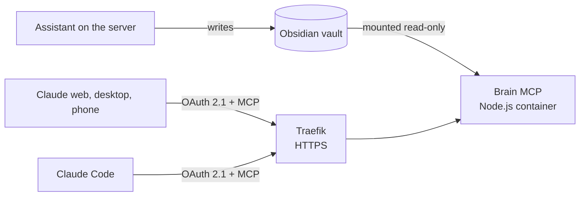

# Brain MCP

[](https://github.com/CarlosChiuAI/brain-mcp/actions/workflows/test.yml)


A small, **read-only** remote [MCP](https://modelcontextprotocol.io) server that shares an Obsidian vault with AI apps (a Claude custom connector, Claude Code, any MCP client), behind a single-user OAuth 2.1 sign-in.

**Why:** I kept re-explaining the same context (projects, decisions, plans) in every AI app. My notes already live in an Obsidian vault that my self-hosted assistant keeps current. Brain lets other AI apps read that vault directly, so every chat starts from the same source of truth. Only the assistant writes. Every outside app can only read.



## What it does

Four tools, all annotated `readOnlyHint`. There is no write path in the code.

| Tool | Use |
|---|---|
| `search_notes` | Find notes by words, optionally inside one folder. Returns paths, modified dates and snippets. |
| `read_note` | Read one note (capped at 200 KB). |
| `list_notes` | List notes, optionally under a folder. |
| `recent_changes` | Notes changed in the last N days, newest first. |

The server also sends **instructions** to the client: start with `Now.md`, cite the note path and date, prefer Brain over the model's own memory, never claim to have edited a note, and quote timestamps in the owner's time zone.

## Security model

- **Read-only, three ways:** no write tools, the vault is mounted `:ro`, and the container root filesystem is read-only (`cap_drop: ALL`, `no-new-privileges`, memory and PID caps).
- **Path rules:** an allowlist (or `*` for the whole vault) plus an optional denylist. Hidden files (`.obsidian/`, `.git/`), non-Markdown files, `..` traversal and symlinks that escape the vault are always refused.
- **OAuth 2.1 for one user:** PKCE, Dynamic Client Registration, and Client ID Metadata Documents accepted only from allowlisted hosts (default `claude.ai`, `claude.com`, `anthropic.com`). One password, stored as a scrypt hash, unlocks the sign-in page. The login endpoint is rate-limited.
- **Tokens:** 1-hour access tokens, 30-day refresh tokens with rotation, 5-minute single-use authorization codes. Only SHA-256 hashes of tokens are written to disk.
- **Sign-in page:** strict CSP (`default-src 'none'`). `form-action` includes the client's redirect origin, because Chrome applies `form-action` to the redirect that follows the form post.
- **Stateless transport:** Streamable HTTP at `/mcp`, a fresh MCP server per request.

Design notes and trade-offs: [docs/DESIGN.md](docs/DESIGN.md).

## Run the tests

```bash
npm ci
npm test
```

The suite covers the vault path rules, OAuth (registration, PKCE, wrong password, single-use codes, redirect checks, refresh rotation, metadata-document host allowlist), the sign-in page CSP, all four tools over HTTP, tokens never stored in plain text, time-zone formatting and config loading.

## Configuration

| Variable | Default | Meaning |
|---|---|---|
| `BRAIN_PUBLIC_URL` | required | Public base URL, e.g. `https://brain.example.com` |
| `BRAIN_PASSWORD_HASH` | required | Output of `node tools/hash-password.mjs` (reads the password from stdin) |
| `BRAIN_VAULT_DIR` | `/vault` | Vault root (mount it read-only) |
| `BRAIN_ALLOW` | `*` | Served top-level folders or files, comma-separated; `*` = whole vault |
| `BRAIN_DENY` | (empty) | Hidden sub-paths, comma-separated |
| `BRAIN_STATE_DIR` | `/state` | Writable dir for client registrations and hashed refresh tokens |
| `BRAIN_CIMD_HOSTS` | `claude.ai,claude.com,anthropic.com` | Hosts allowed to serve client metadata documents |
| `BRAIN_OWNER` | `the owner` | Name used in the instructions sent to the AI |
| `BRAIN_WRITER` | `their assistant` | Who keeps the notes current |
| `BRAIN_TZ` | `UTC` | IANA time zone for `modified` timestamps (ISO 8601 with offset) |
| `PORT` | `8788` | Listen port |

`BRAIN_OWNER`, `BRAIN_WRITER` and `BRAIN_TZ` can also live in `brain.config.json` inside the state dir (`{"owner": "...", "writer": "...", "timeZone": "..."}`). Environment variables win.

## Deploy (Docker host with Traefik)

1. Point a DNS record (e.g. `brain.example.com`) at the host.
2. Put this repo on the host and run `npm ci --omit=dev`.
3. Run `cp deploy/local.env.example deploy/local.env`, then set the domain, vault path and state path.
4. Run `sudo bash deploy/install.sh`. It asks for the password (hashed in a throwaway container, never written in plain text), detects Traefik's network, entrypoint and certificate resolver, writes a hardened `docker-compose.yml` and starts the container.

Change the password later with `sudo bash deploy/install.sh --password`. Remove everything except the vault with `deploy/uninstall.sh`.

## Connect

- **Claude (web, desktop, phone):** Settings > Connectors > Add custom connector > `https://brain.example.com/mcp`, then sign in with the password.
- **Claude Code, one session only:**
  ```bash
  echo '{"mcpServers":{"brain":{"type":"http","url":"https://brain.example.com/mcp"}}}' > brain.json
  claude --mcp-config brain.json --strict-mcp-config
  ```

## Limits

- Plain word search (all words must match); no embeddings or ranking.
- Obsidian links and embeds come back as raw Markdown; there is no graph data.
- Single user by design. A team would need real accounts and per-user scopes.

## How it was built

Built with my self-hosted AI assistant (Hermes Agent running Claude). I set the goal, scope and security requirements, approved the design, ran the deployment on my own server and acceptance-tested it in Claude. The assistant wrote the code and tests. One real bug from deployment is now a regression test: the sign-in page's CSP `form-action 'self'` made Chrome block the redirect back to Claude after a correct password.

Stack: Node.js 22, the official [`@modelcontextprotocol/sdk`](https://github.com/modelcontextprotocol/typescript-sdk), Express 5, zod, Docker, Traefik.

## License

MIT © Carlos Chiu
